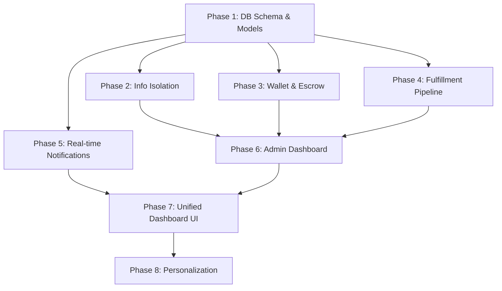

# Medha CampusCart — Complete Architecture Transformation Plan

## Background & Goal

Transform the current Medha CampusCart from a basic e-commerce tab into the **production-grade, privacy-first, operations-controlled marketplace** shown in the architecture diagrams. The target system features:

- **6 logical service domains** (Identity, Catalog, Commerce, Financial, Fulfillment, Notification)
- **Full buyer/seller information isolation** — Medha controls everything
- **Wallet & Escrow** financial layer
- **Fulfillment & Operations pipeline** (pickup → delivery → tracking)
- **Admin/Operations dashboard** with full visibility
- **Real-time notifications** (Socket.io + in-app + email)
- **Unified sidebar dashboard UI** combining Study + Marketplace
- **Complete user personalization** (recommendations, progress, wallet widget)

---

## Current State vs Target Gap Analysis

| Feature | Current | Target |
|---|---|---|
| **Architecture** | Monolithic Next.js API routes | 6 logical service domains in Next.js |
| **Order Flow** | Seller directly sees buyer info | 100% Medha-controlled, no info exchange |
| **Fulfillment** | ❌ None | Full pipeline: pickup → delivery → tracking |
| **Wallets** | ❌ None | Per-user wallet with escrow, payouts, history |
| **Payments DB** | Embedded in Order model | Separate `Payment` collection |
| **Shipments** | ❌ None | Separate `Shipment` collection with tracking |
| **Admin Dashboard** | Basic admin flag | Full operations panel (orders, shipments, agents, disputes) |
| **Info Isolation** | Seller sees buyer phone/name | No buyer info to seller, no seller info to buyer |
| **Real-time** | ❌ None | Socket.io WebSocket + toast notifications |
| **Notification Model** | Basic (type, title, message) | Rich (data payload, category, order-linked, preferences) |
| **UI Layout** | Tab switcher (Revision / Cart) | Unified sidebar dashboard with widgets |
| **Personalization** | ❌ Basic greeting | Full: recommendations, progress, wallet, exam countdown |
| **User Roles** | `user / team / admin` | `buyer / seller / admin / agent` (contextual) |
| **Refunds** | ❌ None | Full refund flow with wallet credit |
| **Agent System** | ❌ None | Delivery agents assigned by admin |

---

## User Review Required

> [!IMPORTANT]
> **Express.js API Gateway**: The diagrams show an Express.js API Gateway. The current app uses Next.js API routes exclusively. I recommend **keeping Next.js API routes** as the "gateway" since they already handle routing, JWT auth, and DB access — adding a separate Express server would duplicate infrastructure. The 6 services will be organized as **logical domains within Next.js**, not separate microservices. Please confirm this approach.

> [!IMPORTANT]
> **Socket.io Real-time**: To add WebSocket support, we need a lightweight server. I recommend creating a small **standalone Socket.io server** (`server/socket.ts`) that runs alongside the Next.js dev server via a single `npm run dev` command. Next.js API routes will emit events to it. This avoids the complexity of a full Express gateway.

> [!WARNING]
> **Database Migration**: The new `Wallet`, `Shipment`, and `Payment` collections will be additive (no data loss). However, the Order model changes (adding `seller_id` as internal-only, removing buyer info from seller-facing APIs) will require modifying existing seller API responses. Existing orders in the DB will still work but won't have the new fields until updated.

---

## Open Questions

> [!IMPORTANT]
> 1. **Agent/Delivery System**: Should delivery agents be real users with login access, or should admin manually manage pickup/delivery status? (The diagrams show agents, but for campus delivery this may be overkill for initial launch.)
> 2. **Escrow Duration**: How long should money be held in escrow after delivery? (Suggested: 48 hours after buyer confirms delivery.)
> 3. **Refund Policy**: Auto-refund to wallet or back to Razorpay? (Suggested: Wallet credit for speed, with optional Razorpay refund for amounts > ₹500.)
> 4. **Payout Method**: How do sellers withdraw from their wallet? (Suggested: Manual bank transfer request reviewed by admin, processed via Razorpay Route/X.)

---

## Proposed Changes

### Phase 1: Database Schema & Models (Foundation)

New MongoDB collections and model updates to support the full architecture.

---

#### [NEW] [Wallet.ts](file:///e:/SE%20LAB/PBL%20PROJECT/MEDHA/medha-next/src/lib/models/Wallet.ts)
```
Fields: user, availableBalance, pendingBalance, totalEarned, totalWithdrawn
Sub-doc: transactions[] { type: credit|debit|escrow|payout|refund, amount, 
         description, orderId?, status, createdAt }
Indexes: user (unique), transactions.orderId
```

#### [NEW] [Shipment.ts](file:///e:/SE%20LAB/PBL%20PROJECT/MEDHA/medha-next/src/lib/models/Shipment.ts)
```
Fields: order, pickupAddress (seller's), deliveryAddress (buyer's), 
        status: pending|pickup_scheduled|picked_up|in_transit|out_for_delivery|delivered|failed
        assignedAgent?, trackingEvents[] { status, timestamp, note, updatedBy },
        estimatedDelivery, actualDelivery, proofOfDelivery?
Indexes: order (unique), status, assignedAgent
```

#### [NEW] [Payment.ts](file:///e:/SE%20LAB/PBL%20PROJECT/MEDHA/medha-next/src/lib/models/Payment.ts)
```
Fields: order, razorpayOrderId, razorpayPaymentId, amount, status,
        escrowStatus: held|released|refunded, escrowReleasedAt?,
        refundId?, refundAmount?, refundReason?
Indexes: order, razorpayOrderId, razorpayPaymentId
```

#### [NEW] [WithdrawalRequest.ts](file:///e:/SE%20LAB/PBL%20PROJECT/MEDHA/medha-next/src/lib/models/WithdrawalRequest.ts)
```
Fields: user, amount, bankDetails { accountName, accountNumber, ifsc, upiId? },
        status: pending|approved|processed|rejected, processedAt?, adminNote?
```

#### [MODIFY] [Order.ts](file:///e:/SE%20LAB/PBL%20PROJECT/MEDHA/medha-next/src/lib/models/Order.ts)
- Add `sellerId` (internal, for admin routing — separate from `items[].seller`)
- Add `fulfillmentStatus` enum matching shipment pipeline
- Add `buyerConfirmedAt`, `disputeReason`, `isDisputed`
- Add `refundStatus: none|requested|processing|completed`
- Remove buyer phone/name from seller-facing API responses (kept in DB, filtered at API layer)

#### [MODIFY] [User.ts](file:///e:/SE%20LAB/PBL%20PROJECT/MEDHA/medha-next/src/lib/models/User.ts)
- Add `phone` field (for delivery coordination, admin-only visible)
- Add `isVerifiedStudent` boolean
- Add `sellerVerified` boolean  
- Add `savedAddresses[]` sub-document for quick checkout
- Ensure `role` supports contextual check (user can be both buyer AND seller)

#### [MODIFY] [Notification.ts](file:///e:/SE%20LAB/PBL%20PROJECT/MEDHA/medha-next/src/lib/models/Notification.ts)
- Add `category: order|payment|delivery|product|system|study`
- Add `data` (JSON payload for order ID, product ID, etc.)
- Add `actionUrl` (deep link to relevant page)
- Add `priority: low|normal|high|urgent`

#### [MODIFY] [index.ts](file:///e:/SE%20LAB/PBL%20PROJECT/MEDHA/medha-next/src/lib/models/index.ts)
- Export new models: Wallet, Shipment, Payment, WithdrawalRequest

---

### Phase 2: Information Isolation & Security Layer

The core architectural principle: **buyers and sellers NEVER see each other's info**.

---

#### [NEW] [info-filter.ts](file:///e:/SE%20LAB/PBL%20PROJECT/MEDHA/medha-next/src/lib/utils/info-filter.ts)
Middleware utilities to strip sensitive fields based on user role:
- `filterOrderForSeller(order)` → removes buyer name, phone, address details; shows only order items, amount, status
- `filterOrderForBuyer(order)` → removes seller identity; shows only product name, status, tracking
- `filterOrderForAdmin(order)` → full visibility
- Applied at the API response layer in every order/seller/buyer endpoint

#### [MODIFY] [seller/orders/route.ts](file:///e:/SE%20LAB/PBL%20PROJECT/MEDHA/medha-next/src/app/api/campus-cart/seller/orders/route.ts)
- Apply `filterOrderForSeller()` to all responses
- Seller sees: order ID, items, quantity, earning amount, fulfillment status
- Seller does NOT see: buyer name, phone, address, college, hostel

#### [MODIFY] [orders/route.ts](file:///e:/SE%20LAB/PBL%20PROJECT/MEDHA/medha-next/src/app/api/campus-cart/orders/route.ts)
- Apply `filterOrderForBuyer()` to buyer's order list
- Buyer sees: product name, price, order status, tracking
- Buyer does NOT see: seller name, seller phone, seller address

#### [MODIFY] [orders/[id]/route.ts](file:///e:/SE%20LAB/PBL%20PROJECT/MEDHA/medha-next/src/app/api/campus-cart/orders/%5Bid%5D/route.ts)
- Role-based filtering on order detail endpoint
- Cancel order now only allowed in `pending` state (not `confirmed`)

---

### Phase 3: Financial Service (Wallet & Escrow)

---

#### [NEW] [wallet/route.ts](file:///e:/SE%20LAB/PBL%20PROJECT/MEDHA/medha-next/src/app/api/campus-cart/wallet/route.ts)
- `GET` — fetch user's wallet (balance, pending, transaction history)
- `POST` — admin-only: credit/debit wallet

#### [NEW] [wallet/withdraw/route.ts](file:///e:/SE%20LAB/PBL%20PROJECT/MEDHA/medha-next/src/app/api/campus-cart/wallet/withdraw/route.ts)
- `POST` — seller requests withdrawal (amount, bank details)
- Validates available balance ≥ requested amount

#### [NEW] [escrow.ts](file:///e:/SE%20LAB/PBL%20PROJECT/MEDHA/medha-next/src/lib/services/escrow.ts)
Escrow lifecycle service:
- `holdInEscrow(orderId, amount)` — on payment capture
- `releaseFromEscrow(orderId)` — on delivery confirmation + cooldown
- `refundFromEscrow(orderId, reason)` — on dispute/cancellation
- Automatically credits seller wallet on release
- Deducts platform commission before credit

#### [MODIFY] [payment/verify/route.ts](file:///e:/SE%20LAB/PBL%20PROJECT/MEDHA/medha-next/src/app/api/campus-cart/payment/verify/route.ts)
- After verification: create `Payment` record, hold funds in escrow
- Don't credit seller wallet immediately — wait for delivery

---

### Phase 4: Fulfillment & Operations Pipeline

The completely new operations layer.

---

#### [NEW] [fulfillment/route.ts](file:///e:/SE%20LAB/PBL%20PROJECT/MEDHA/medha-next/src/app/api/campus-cart/fulfillment/route.ts)
- `GET` — admin fetches all shipments (filterable by status)
- `POST` — admin creates shipment for an order

#### [NEW] [fulfillment/[id]/route.ts](file:///e:/SE%20LAB/PBL%20PROJECT/MEDHA/medha-next/src/app/api/campus-cart/fulfillment/%5Bid%5D/route.ts)
- `PUT` — admin updates shipment status (pickup_scheduled → picked_up → in_transit → out_for_delivery → delivered)
- Each status change adds a tracking event and triggers notification

#### [NEW] [fulfillment/tracking/[orderId]/route.ts](file:///e:/SE%20LAB/PBL%20PROJECT/MEDHA/medha-next/src/app/api/campus-cart/fulfillment/tracking/%5BorderId%5D/route.ts)
- `GET` — buyer views tracking events for their order (filtered, no agent info)

#### [NEW] [fulfillment.ts](file:///e:/SE%20LAB/PBL%20PROJECT/MEDHA/medha-next/src/lib/services/fulfillment.ts)
Core fulfillment service:
- `createShipment(orderId)` — auto-creates on order confirmation
- `schedulePickup(shipmentId, agentId?)` — admin assigns
- `markPickedUp(shipmentId, proofUrl?)` 
- `markDelivered(shipmentId, proofUrl?)` — triggers escrow release countdown
- `getETAEstimate(pickupCollege, deliveryCollege)` — simple college-distance estimation

---

### Phase 5: Real-Time Notification System

---

#### [NEW] [server/socket.ts](file:///e:/SE%20LAB/PBL%20PROJECT/MEDHA/medha-next/server/socket.ts)
Standalone Socket.io server (runs on port 3001):
- Authenticates via JWT on connection
- Rooms per user ID for targeted notifications
- Events: `notification:new`, `order:status_changed`, `delivery:update`

#### [NEW] [notification-service.ts](file:///e:/SE%20LAB/PBL%20PROJECT/MEDHA/medha-next/src/lib/services/notification-service.ts)
Unified notification dispatcher:
- `notify(userId, { type, title, message, category, data, priority })`
- Saves to MongoDB `notifications` collection
- Emits via Socket.io to connected user
- Sends email for high-priority (order confirmed, delivered, payout)
- Respects user notification preferences

#### [NEW] [notification-preferences/route.ts](file:///e:/SE%20LAB/PBL%20PROJECT/MEDHA/medha-next/src/app/api/campus-cart/notification-preferences/route.ts)
- `GET/PUT` — user manages which notifications they receive (email, push, in-app)

#### [NEW] [useNotifications.ts](file:///e:/SE%20LAB/PBL%20PROJECT/MEDHA/medha-next/src/hooks/useNotifications.ts)
Client-side hook:
- Connects to Socket.io server
- Manages real-time notification state
- Shows toast/bell badge
- Falls back to polling if WebSocket unavailable

#### [NEW] [NotificationBell.tsx](file:///e:/SE%20LAB/PBL%20PROJECT/MEDHA/medha-next/src/components/common/NotificationBell.tsx)
- Bell icon with unread count badge
- Dropdown panel showing recent notifications
- Mark as read / mark all read
- Links to relevant pages

---

### Phase 6: Admin/Operations Dashboard

Full admin panel for managing the marketplace operations.

---

#### [NEW] [admin/operations/page.tsx](file:///e:/SE%20LAB/PBL%20PROJECT/MEDHA/medha-next/src/app/campus-cart/admin/operations/page.tsx)
Operations dashboard with tabs:
- **Orders**: All orders with full buyer+seller info, status management
- **Shipments**: Fulfillment pipeline kanban (pending → pickup → transit → delivered)
- **Payments**: Payment status, escrow holds, refunds
- **Users**: User management, verification
- **Disputes**: Handle buyer/seller disputes
- **Reports**: Revenue analytics, commission earned, order volume

#### [NEW] [admin/orders/route.ts](file:///e:/SE%20LAB/PBL%20PROJECT/MEDHA/medha-next/src/app/api/campus-cart/admin/orders/route.ts)
- Admin-only: fetch ALL orders with full info (buyer + seller + payment + shipment)
- Filter by status, date range, seller, buyer
- Bulk status update

#### [NEW] [admin/withdrawals/route.ts](file:///e:/SE%20LAB/PBL%20PROJECT/MEDHA/medha-next/src/app/api/campus-cart/admin/withdrawals/route.ts)
- Admin reviews and processes seller withdrawal requests
- Approve/reject with notes

#### [NEW] [admin/reports/route.ts](file:///e:/SE%20LAB/PBL%20PROJECT/MEDHA/medha-next/src/app/api/campus-cart/admin/reports/route.ts)
- Platform revenue (total commission earned)
- Order volume by day/week/month
- Top sellers, top products
- Pending payouts total

#### [NEW] [middleware/admin-guard.ts](file:///e:/SE%20LAB/PBL%20PROJECT/MEDHA/medha-next/src/lib/utils/admin-guard.ts)
- `requireAdmin(req)` — ensures `user.isAdmin === true`
- Applied to all admin API routes

---

### Phase 7: Unified Sidebar Dashboard UI

Complete redesign matching the UI mockup (Image 3).

---

#### [NEW] [DashboardLayout.tsx](file:///e:/SE%20LAB/PBL%20PROJECT/MEDHA/medha-next/src/components/dashboard/DashboardLayout.tsx)
Unified layout with:
- **Left sidebar** (collapsible on mobile):
  - Home, Activity, Messages (badge), Notifications (badge)
  - STUDY section: My Subjects, Revision Notes, PYQs, Important Qs, Mind Maps, Flashcards, Practice & Tests
  - MARKETPLACE section: Browse, My Listings, Orders, Wishlist
  - User profile card at bottom (avatar, name, college)
- **Main content area**: Dynamic based on active route
- **Right sidebar** (hidden on mobile): Widgets column

#### [NEW] [DashboardHome.tsx](file:///e:/SE%20LAB/PBL%20PROJECT/MEDHA/medha-next/src/components/dashboard/DashboardHome.tsx)
Main dashboard content:
- Personalized greeting ("Good evening, Ayush! 👋")
- Two hero cards: "Study for Exams" + "Buy & Sell on Campus"
- "Continue Your Revision" — subject progress cards with % completion
- "Recommended for You" — tabbed (Marketplace / Study) product/content carousel

#### [NEW] [WidgetSidebar.tsx](file:///e:/SE%20LAB/PBL%20PROJECT/MEDHA/medha-next/src/components/dashboard/WidgetSidebar.tsx)
Right-side widgets:
- **Upcoming Exam** countdown (linked to UserSyllabus)
- **Wallet & Earnings** widget (balance, monthly earnings, "Add Money" CTA)
- **Quick Actions** grid (Sell an Item, Upload Notes, Ask Doubt, Find Roommate)
- **Trending Searches** tag cloud

#### [MODIFY] [layout.tsx](file:///e:/SE%20LAB/PBL%20PROJECT/MEDHA/medha-next/src/app/%28revision%29/layout.tsx)
- Replace top navbar + plain content layout with `DashboardLayout`
- Wrap both revision and campus-cart authenticated pages inside the unified sidebar layout

#### [MODIFY] [page.tsx](file:///e:/SE%20LAB/PBL%20PROJECT/MEDHA/medha-next/src/app/page.tsx)
- Unauthenticated: Keep current landing page (Revision/CampusCart tab switcher)
- Authenticated: Redirect to `/dashboard` which uses the unified sidebar layout

#### [NEW] [dashboard/page.tsx](file:///e:/SE%20LAB/PBL%20PROJECT/MEDHA/medha-next/src/app/%28revision%29/dashboard/page.tsx) (rewrite)
- Replace current semester picker with the full unified `DashboardHome`

---

### Phase 8: User Personalization

---

#### [NEW] [UserPreferences.ts](file:///e:/SE%20LAB/PBL%20PROJECT/MEDHA/medha-next/src/lib/models/UserPreferences.ts)
```
Fields: user, notificationPrefs { email, push, inApp per category },
        dashboardWidgets[] (which widgets to show, order),
        recentSearches[], viewedProducts[], viewedSubjects[],
        examDates[] { subject, examDate, examType }
```

#### [NEW] [personalization/route.ts](file:///e:/SE%20LAB/PBL%20PROJECT/MEDHA/medha-next/src/app/api/campus-cart/personalization/route.ts)
- `GET` — returns personalized data bundle:
  - Product recommendations (based on college, category views, branch)
  - Study recommendations (based on subjects, progress)
  - Upcoming exams (from UserSyllabus + exam dates)
  - Wallet summary
  - Notification count
  - Continue studying subjects with progress %

#### [NEW] [usePersonalization.ts](file:///e:/SE%20LAB/PBL%20PROJECT/MEDHA/medha-next/src/hooks/usePersonalization.ts)
Client-side hook that fetches and caches the personalization bundle on dashboard load.

#### [MODIFY] Products API
- Add `GET /api/campus-cart/products/recommended` — personalized product feed based on:
  - Same college products first
  - Branch-relevant categories (CS → electronics, lab equipment)
  - Recently viewed category boosting
  - Popular products as fallback

#### [NEW] [activity-tracker.ts](file:///e:/SE%20LAB/PBL%20PROJECT/MEDHA/medha-next/src/lib/services/activity-tracker.ts)
Lightweight activity tracking:
- `trackProductView(userId, productId)`
- `trackSearch(userId, query)`
- `trackSubjectProgress(userId, subjectId, progress)`
- Used to power recommendations

---

## Verification Plan

### Automated Tests
```bash
# TypeScript compilation
npm run type-check

# Test all API routes respond correctly
# (manual curl/Postman for now, automated tests in future)
```

### Manual Verification
1. **Info Isolation**: Login as seller → view orders → verify no buyer name/phone visible
2. **Info Isolation**: Login as buyer → view orders → verify no seller name/phone visible  
3. **Wallet Flow**: Place order → verify payment held in escrow → admin confirms delivery → verify seller wallet credited
4. **Fulfillment Pipeline**: Admin creates shipment → updates status through each stage → buyer sees tracking
5. **Real-time**: Open two browser tabs (buyer + seller) → place order → verify both receive toast notification
6. **Dashboard UI**: Login → verify unified sidebar layout with all widgets rendering correctly
7. **Personalization**: Verify "Recommended for You" shows college-relevant products
8. **Admin Panel**: Login as admin → verify full order/payment/shipment visibility

---

## Implementation Order & Dependencies



**Estimated effort**: ~3-4 days of focused implementation across all 8 phases.
